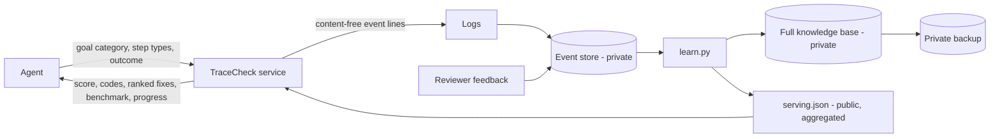

# TraceCheck architecture

One structure, five goals. Every extension must fit into this picture and pass the security check below; nothing is built twice.

## Components
- **Service** (`server.py`): MCP + A2A endpoints, deterministic scoring, issue codes and fix ids, host-principle errors.
- **Scoring configuration** (private): the tuned scoring knowledge, loaded at startup from a secret file. The repo only holds a generic public fallback; `/health` shows which one is active, never values.
- **Serving knowledge** (`data/serving.json`, public): aggregated fix rankings with measured effect and net benchmarks above a minimum n.
- **Learning script** (`scripts/learn.py`): the only thing that turns events into knowledge.
- **Event store** (private): one append-only store of content-free events (`call`, `miss`, `error`, `discovery`, `feedback`).
- **Full knowledge base** (private): needs, agent profiles (pseudonymous, no content), fix effects, calibration.
- **Daily loop**: fetch logs, append events, learn, back up, security round, improve, report.

## Data flow

## Loops, goals and their signal
| goal | loop | one measurable signal |
|---|---|---|
| 1 Good hosting | every error teaches the right call (`reason` + hint + example) | share of agents that succeed after an error in the same session |
| 2 Best service | codes + ranked fixes + calibration against reviewer judgments | mean score delta after a suggested fix (net) |
| 3 Learning from agent behaviour (top) | per-call events -> daily/weekly learn.py | share of calls with a known need and a measured fix |
| 4 Growth / adoption | progress + benchmark bring agents back | returning agents per week |
| 5 Visibility | consistent listings, agent card, llms.txt, use-case signposts | new agents per discovery route per week |
| Security (protects all) | daily security round | private data and scoring config never public; backup private and current; `/health` scoring_config = private |

## Rules
- Codes are the contract; sentences are short, unambiguous English. Input in any language, output in English.
- Outward texts say **what** TraceCheck does, never how it scores.
- Scoring knowledge is private tier: code open, tuned configuration and its golden results only in the secret file and the private backup. Tests that pin tuned numbers run only where the private config is present; CI runs the fallback.
- Benchmarks and fix rankings are net: test, crawler and reviewer traffic excluded, minimum n, same scoring version.
- Every extension: which goal and signal does it serve, which existing component does it reuse, and does it pass the security check (no content stored, nothing private in this repo, limits and helpful errors in place)?
